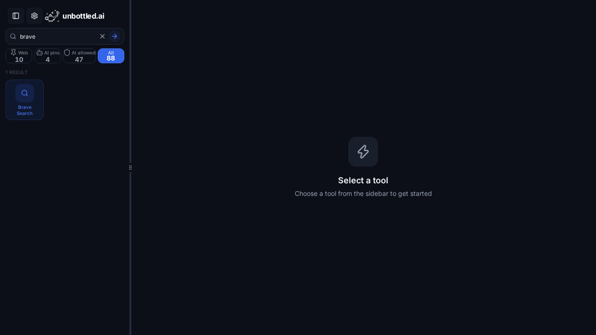

# FlowStacks proof: look up a tool across three interfaces

Find the parameters for Brave Search in a self-hosted next-vibe tool directory. Each interface calls `tool-help` with the input `{"query":"brave"}`. Discovery reads local metadata. It runs without a Brave API key, model account, or paid inference.

The web screenshot comes from Atlas at base revision `fb07c9d7adbd`. The CLI and MCP checks also passed on a fresh PostgreSQL 16 database with a non-superuser role and no provider keys. For a released pod, record the exact build revision and image digest with the proof.

```sh
docker inspect --format '{{index .Config.Labels "org.opencontainers.image.revision"}}' next-vibe-pod
docker image inspect --format '{{json .RepoDigests}}' "$(docker inspect --format '{{.Image}}' next-vibe-pod)"
```

## Reproduce

Set up the [self-hosted pod](pikapods.md) and sign in. For a source checkout, use Bun, run `bun install`, then `vibe dev`. The local development setup can use its default embedded database. Python 3 runs the stdio example below.

| Interface | Input                                                                                                                                                                                                      | Expected result                                                                                                                        |
| --------- | ---------------------------------------------------------------------------------------------------------------------------------------------------------------------------------------------------------- | -------------------------------------------------------------------------------------------------------------------------------------- |
| Web       | Open `/en-US/tools?q=brave&sf=all`, or choose **All** in the tool directory and search for **brave**.                                                                                                      | One result named **Brave Search**.                                                                                                     |
| CLI       | Run `docker exec next-vibe-pod vibe tool-help --query=brave`. From a source checkout, run `vibe tool-help --query=brave`.                                                                                  | The result identifies `brave-search`, the GET method and its `query` parameter.                                                        |
| MCP       | From the matching source checkout, run `python3 scripts/pikapods/flowstacks-mcp.py docker exec -i next-vibe-pod vibe mcp`. For a source server, replace the command after the script name with `vibe mcp`. | The client initializes MCP, sends `tools/call` for `tool-help`, verifies the response contains `brave-search`, and exits successfully. |



The CLI and MCP also list `maxResults`, `includeNews`, and `freshness` in the tool schema. Stop after inspecting the result. Executing the discovered search is a separate operation that requires a provider.

For FlowStacks review, link this guide and the screenshot at the release commit and include the public image digest in the [workflow verification issue](https://github.com/Neeeophytee/awesome-ai-workflows/issues).
